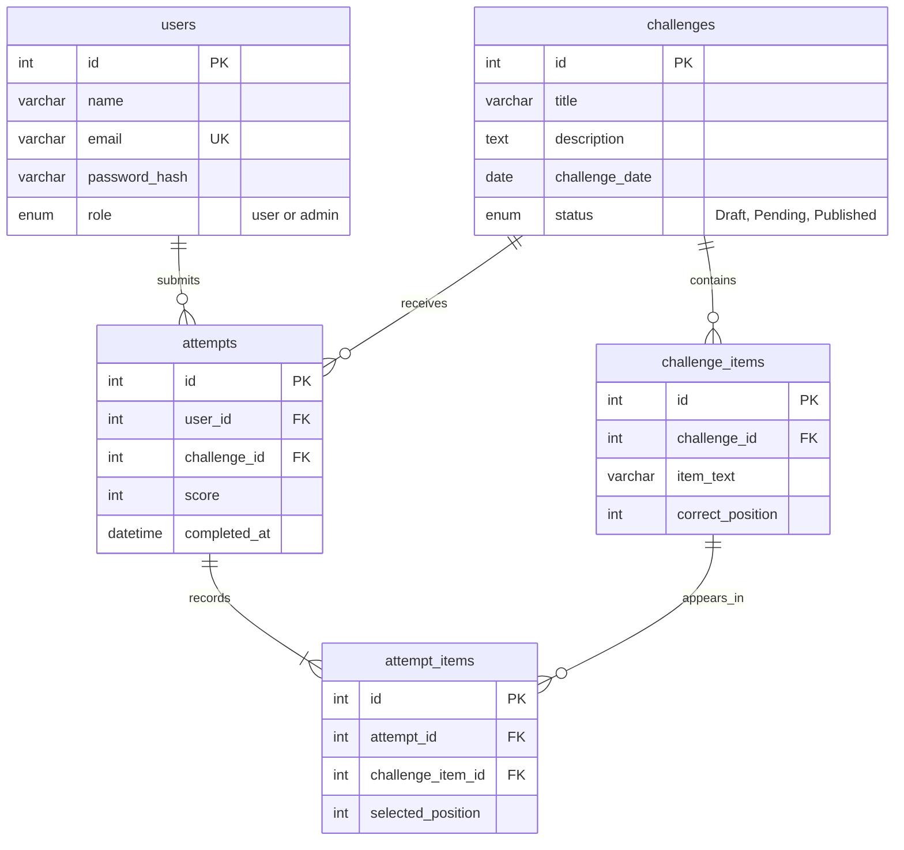

# Rank It: draft entity-relationship diagram

Milestone 1 planning only. No SQL schema, connection or database has been created.

## Relationships and planned rules

- A user submits many attempts; each attempt belongs to one user. Admins are users with `role = admin`.
- A challenge contains many challenge items and receives many attempts. Each item belongs to one challenge. A published challenge must have exactly five items, with unique correct positions 1-5.
- An attempt contains five attempt items when completed. Each selected item references one challenge item. The item must belong to the same challenge as the attempt.
- A challenge item can appear in many players' attempt items. These rows preserve each player's selected order separately from the answer.

Planned constraints: unique email; unique `(user_id, challenge_id)` for one completed daily attempt; unique `(challenge_id, correct_position)`; unique `(attempt_id, selected_position)` and `(attempt_id, challenge_item_id)`. Only one published challenge should be available for each date. Drafts may share a proposed date, so publication needs a service-level date check.

Scores are computed by the backend in a later milestone: matching positions multiplied by 20, from 0 to 100. For a permutation of five distinct items, exactly four correct positions is impossible; 80 is therefore not a possible completed score under this rule.

Drafts may be incomplete while being edited. Publishing and completion constraints will be checked in future services. Deleting users, challenges, items or attempts requires an explicit future retention/cascade policy so linked history remains consistent. The M1 admin forms demonstrate each entity's interface, without enforcing database relationships or synchronizing the separate player fixtures.

Future AI suggestions become ordinary draft challenges and challenge items after review. This does not require an additional core entity.
